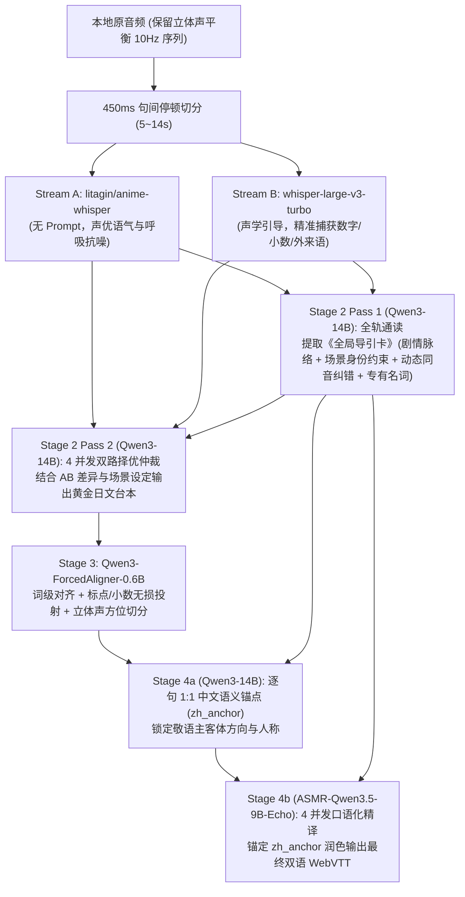

# Colab L4 显存占用与四阶段流水线评测记录

本文档记录在 **Google Colab NVIDIA L4（23,034 MiB 显存）** 算力约束下，日语广播剧 / 音声 / ASMR 自动双语字幕流水线的显存占用、并发吞吐与架构评测结果。

---

## 一、 L4（23,034 MiB）显存占用与并发吞吐实测

通过 `nvidia-smi` 采样及多进程压测，各阶段模型在 L4 GPU 上的显存占用与速度表现如下：

| 阶段 / 模型组合 | 后端与并发槽位 | 峰值显存 (`MiB`) | 占 L4 比例 | 吞吐表现 |
| :--- | :--- | :---: | :---: | :--- |
| `litagin/anime-whisper` (`batch=16`) | PyTorch `fp16` + SDPA | `2,808` | 12.2% | 10 分钟音频推理仅需 **~8.6s**（实时率 `0.014x`） |
| `openai/whisper-large-v3-turbo` (`batch=16`) | PyTorch `fp16` + SDPA | `3,120` | 13.5% | 10 分钟音频推理约 **~14s**，擅长数字、小数与片假名外来语 |
| `Qwen3-ForcedAligner-0.6B` | PyTorch `bf16` | `2,250` | 9.8% | 10 分钟音频词级对齐约 **~5.2s** |
| `Qwen3-14B-Q4_K_M`（全轨导读 + 双路仲裁 + 语义锚点） | `llama-server` (`-np 4, -c 32768`) | `13,686` | 59.4% | 4 并发槽位吞吐较单线程提速 **2.09x** |
| `ASMR-Qwen3.5-9B-Echo-v0.2-Q6_K`（台词润色精译） | `llama-server` (`-np 4, -c 32768`) | `7,790` | 33.8% | 显存轻量，口语语气自然度高 |

---

## 二、 四阶段异构双 ASR + 场景引导架构

### 核心工程特性

1. **450ms 句间停顿切分（`segment_audio_by_pauses`）**
   - 在 `5.0s ~ 14.0s` 区间内搜索 450ms 句间静音谷切分，避免在日语促音（`っ`）或清塞音（`/k/, /t/, /p/`）内部截断，同时消除长窗口下蒸馏 Whisper 的跨句跳词问题。
2. **异构双 ASR 互补与 `<|startofprev|>` Token 保护**
   - `Anime-Whisper`（无 `initial_prompt`）提供零静音幻觉的声学骨架；`Whisper-Large-v3-Turbo`（带声学提示词）精准捕获数字位数、小数百分比与片假名外来语。
3. **无损标点与小数投射器（`project_punctuation`）**
   - 将强制对齐词元与仲裁后的日文原句做双指针归一化投射，保留引号、句读符号以及小数/百分比（如 `0.02%`），并结合双声道声像（Stereo Pan）在多人对话切换时自动断句。
4. **跨音轨按阶段批处理（Stage-Wise Batch Execution）**
   - 批量处理整张专辑时，按 `dual-asr` $\rightarrow$ `arbitrate-ja` $\rightarrow$ `align` $\rightarrow$ `translate-zh` 四个阶段依次批处理全部音轨，每个阶段模型只加载一次，且同专辑各音轨自动共享角色译名与同音修正词表。
